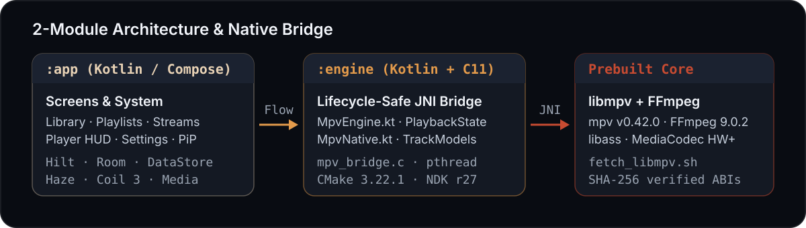

<p align="center">
  
</p>

<p align="center">
  <a href="https://github.com/ySimoz/jupiter/releases/tag/v0.1.1">Download v0.1.1 Beta APK</a>
  ·
  <a href="#features">Features</a>
  ·
  <a href="#architecture--tech-stack">Architecture</a>
  ·
  <a href="#build-from-source">Build from Source</a>
</p>

Native Android media player built on top of **libmpv** and **Jetpack Compose**.

---

## Quick Start (v0.1.1 Beta)

1. Download **`jupiter-v0.1.1-beta.apk`** from the [v0.1.1 GitHub Release](https://github.com/ySimoz/jupiter/releases/tag/v0.1.1).
2. Install on Android 10 or newer (`arm64-v8a`, `armeabi-v7a`, or `x86_64`).

> **Beta signing note:** `v0.1.1` is an early beta release. As configured in [`app/build.gradle.kts`](app/build.gradle.kts), the current release build signs with the local debug keystore.

---

## Features

### Playback Engine (`libmpv`)
- **Hardware & software decoding:** Switch between `Auto`, `HW` (`mediacodec-copy`), `HW+` (`mediacodec`), and `SW` decoding.
- **Power controls:** Playback speed (`0.75x`–`2.0x` plus long-press `2x` boost), aspect modes (`Fit`, `Fill`, `Stretch`, `16:9`, `4:3`, `21:9`), A-B loop, video equalizer (brightness, contrast, saturation, gamma), chapter navigation, timestamp bookmarks, and frame capture.
- **Custom `mpv.conf`:** Import your own `mpv.conf` file from Settings or reset to defaults at any time.

### Subtitles & Audio
- **Formats:** Embedded tracks plus external `.srt`, `.ass`, `.ssa`, and `.vtt` files with `libass` rendering.
- **Controls:** Secondary subtitle track, subtitle font scaling (`0.5x`–`2.5x`), subtitle & audio delay steppers, and preferred audio/subtitle language codes.

### Gestures, PiP & Background Playback
- **Touch gestures:** Vertical brightness drag, vertical volume drag, horizontal seek scrub, configurable double-tap seek (`5s` / `10s` / `15s` / `30s`), pinch-to-zoom, and player lock.
- **Multitasking:** Picture-in-Picture (PiP) with replay/play-pause/forward controls and background audio playback via `MediaPlaybackService` + `MediaSessionCompat`.

### Library, Playlists & Network Streams
- **Local media:** `MediaStore` folder/video scanner, Storage Access Framework (SAF) file and folder picker, Continue Watching resume state, and external `ACTION_VIEW` intent handling.
- **Playlists & queue:** Create playlists, reorder/play queues, and toggle auto-play next with an Up Next countdown.
- **Network streams:** Play `HTTP`, `HTTPS`, `HLS` (`.m3u8`), `DASH` (`.mpd`), and `RTSP` URLs with custom HTTP headers and saved stream bookmarks.

### Adaptive Glass UI
- **Responsive layout:** Bottom glass bar on phones and glass navigation rail on tablets (`material3-window-size-class`).
- **Customization:** `Solid`, `Frosted`, and `Clear` glass styles (Haze), background/accent/text color wheel pickers, adjustable corner roundness, and optional navigation labels.

---

## Architecture & Tech Stack

<p align="center">
  
</p>

Jupiter uses a two-module Gradle layout (`:app` and `:engine`) backed by reproducible prebuilt native binaries fetched by [`scripts/fetch_libmpv.sh`](scripts/fetch_libmpv.sh).

| Layer | Implementation | Version / Target |
| :--- | :--- | :--- |
| **Android SDK** | `minSdk 29` · `compileSdk 35` · `targetSdk 35` | Android 10+ |
| **Language** | Kotlin + C11 (`-std=c11 -Wall -Wextra -Werror`) | Kotlin `2.1.21` |
| **Native Engine** | `dev.jdtech.mpv:libmpv:1.1.0` (`mpv` + `FFmpeg` + `libass`) | mpv `0.42.0` / FFmpeg `9.0.2` |
| **NDK / CMake** | `arm64-v8a`, `armeabi-v7a`, `x86_64` | NDK `27.3.13750724` / CMake `3.22.1` |
| **UI & Blur** | Jetpack Compose BOM `2025.05.01` + Material 3 + Haze | Haze `1.6.10` |
| **DI & Async** | Hilt `2.56.2` + KSP + Kotlin Coroutines `1.10.2` | Navigation Compose `2.9.0` |
| **Persistence** | Room `2.7.2` + DataStore Preferences `1.1.7` | Coil `3.2.0` + `androidx.media` `1.7.0` |

---

## Build from Source

### Prerequisites
- **JDK 17**
- **Android SDK 35**, **NDK `27.3.13750724`**, and **CMake `3.22.1`**
- `curl`, `unzip`, and `shasum` / `sha256sum`

### Steps

1. Clone the repository:

```bash
git clone https://github.com/ySimoz/jupiter.git
cd jupiter
```

2. Fetch and SHA-256 verify prebuilt `libmpv` shared libraries and `mpv` headers (these are excluded from Git via `.gitignore`):

```bash
./scripts/fetch_libmpv.sh
```

3. Run unit tests and build an APK:

```bash
# Debug APK
./gradlew :app:assembleDebug

# Unit tests + release APK
./gradlew :engine:testDebugUnitTest :app:testDebugUnitTest :app:assembleRelease
```

The release APK is written to `app/build/outputs/apk/release/app-release.apk`.

---

<p align="center">
  
</p>
